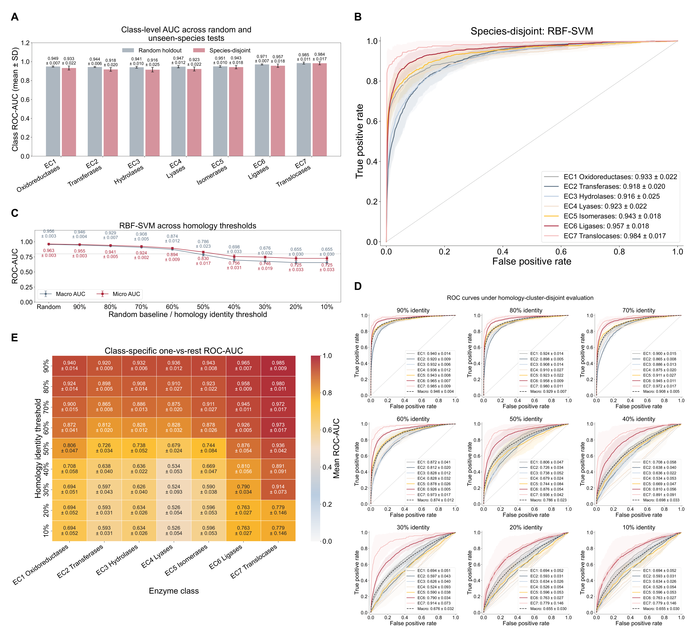

# ArchaEC-SVM

ArchaEC-SVM is a sequence-feature framework for seven-class, multilabel archaeal enzyme prediction. It combines 20 amino-acid composition (AAC), 400 dipeptide composition (DPC), and 12 physicochemical descriptors. Training-only mRMR ranking and validation-based incremental feature selection (IFS) precede seven class-balanced radial-basis-function support vector machines (RBF-SVMs).

The repository contains the frozen UniProtKB/Swiss-Prot dataset, homology assignments, five-fold split manifests, portable training and prediction entry points, original experiment/plotting source, sample-level out-of-fold predictions, and the current Figures 2–6. The organization follows [TasteMM](https://github.com/llllxw/TasteMM), but the data, models, and evaluation protocol here are specific to archaeal enzymes.

**Scope:** this predicts top-level EC labels among annotated enzymes. It is not an enzyme/non-enzyme detector, a full-EC-number predictor, or an experimentally validated activity assay. Sigmoid-transformed SVM margins are **uncalibrated scores**, not calibrated probabilities. The separately trained multifunctionality classifier does not share parameters with the seven main classifiers.

## 1. Environment

Python 3.12 is recommended; the source experiments used Python 3.12.7. The lightweight SVM installation is CPU-only and does not require PyTorch, LightGBM, or SHAP:

```bash
conda env create -f environment.yml
conda activate archaec-svm
python scripts/smoke_test.py
```

Alternatively, in a Python 3.12 environment:

```bash
python -m pip install -r requirements.txt
python scripts/smoke_test.py
```

The smoke test fits seven small classifiers on synthetic sequences. A `PASS` checks installation and data flow; it is not a benchmark result. Optional figure/KernelSHAP dependencies and all seven comparator dependencies are separate:

```bash
python -m pip install -r requirements-analysis.txt
python -m pip install -r requirements-comparison.txt
```

Arial is used by the publication figures. If it is unavailable, install an appropriately licensed Arial font or expect font substitution. Original recorded package versions are in [docs/original_run/execution_environment.json](docs/original_run/execution_environment.json).

## 2. Dataset and provenance

The frozen source is **UniProtKB/Swiss-Prot release 2026_02**, retrieved on **19 July 2026**, with query `(reviewed:true) AND (taxonomy_id:2157) AND (ec:*)`. It comprises **11,425 accession-level records**, **10,854 unique sequences**, **204 taxonomy IDs**, and **262 proteins annotated with more than one top-level EC class**. Accessions were not collapsed to one row per unique sequence; identical sequences are kept together during splitting.

| EC class | Enzyme class | Positive accessions |
| --- | --- | ---: |
| EC1 | Oxidoreductases | 1,215 |
| EC2 | Transferases | 4,030 |
| EC3 | Hydrolases | 2,301 |
| EC4 | Lyases | 1,330 |
| EC5 | Isomerases | 734 |
| EC6 | Ligases | 1,807 |
| EC7 | Translocases | 271 |

Multilabel accessions contribute to multiple counts. The released master CSV includes sequences, EC annotations, taxonomy, annotation evidence, and binary labels. See [data/README.md](data/README.md), [DATA_SOURCES.md](DATA_SOURCES.md), and [data/label_mapping.csv](data/label_mapping.csv). A live database download will not necessarily reproduce this frozen release.

Audit the release without changing any input:

```bash
python scripts/validate_release.py
python scripts/validate_release.py --all-features
python -m unittest discover -s tests -v
```

The audit verifies source hashes, feature ordering, sequence hashes, label counts, split isolation, full out-of-fold coverage, and stored SVM generalization metrics. `--all-features` recomputes the 432 descriptors for every sequence and checks exact equality with the released feature matrix.

## 3. Evaluation protocol

There are five **outer** grouped test folds. Within each outer training partition, a grouped validation holdout is reserved, resulting in approximately 64% fitting, 16% validation, and 20% test data. This is **not five-by-five nested cross-validation**. The same frozen partitions are used for matched algorithm comparisons and feature ablations.

- Random: identical sequences remain in the same group.
- Species-disjoint: taxonomy groups are transitively united with identical-sequence groups.
- Homology-disjoint: MMseqs2 cluster groups are transitively united with identical-sequence groups, at 10%–90% identity thresholds in steps of 10%.

mRMR uses training-only quantile discretization with at most ten bins. Relevance is the average mutual information with seven binary labels; redundancy is the mean mutual information with already selected features. IFS considers 16, 32, 64, 128, 256, and 432 features, maximizing inner-validation macro ROC-AUC and choosing the smaller prefix on a tie. The scaler is fitted on the inner training data only. The selected model is not refitted with validation data. All five random folds selected 432 features; this does not demonstrate dimensionality reduction.

The main SVM settings are `C=2`, `gamma="scale"`, `class_weight="balanced"`, and `probability=False`. Class-specific decision thresholds maximize validation F1 over 0.01–0.99. Accuracy is exact multilabel match; Precision, Recall, F1, Specificity, and MCC are macro-averaged. Mean ± SD refers to five fold-level values, with sample SD (`ddof=1`), not one AUC calculated after pooling all out-of-fold predictions.

## 4. Training and prediction

Train one random fold with the final SVM configuration:

```bash
python train.py --design random --fold 0
```

Train all five folds, with checkpoints and a cumulative six-hour limit for this invocation's design/algorithm/feature-group experiment:

```bash
python train_5fold.py --design random --hours 6
python train_5fold.py --design random --hours 6 --resume
```

The limit does not promise that training will finish on every machine. Resume retains completed class/prefix checkpoints and rejects changed inputs, code, or recorded environment. Other designs can be run independently:

```bash
python train_5fold.py --design species --hours 6
python train_5fold.py --design homology_40 --hours 6
```

Each run creates a selected `model.joblib`, `columns.npy`, validation predictions, test predictions, class thresholds, input fingerprints, and metrics under `runs/`. A fold model is an evaluation model, not a separately trained all-data deployment model. Pretrained weights are not bundled: the original single-fold SVM pack is approximately 84 MB, and the complete experimental checkpoint collection is much larger. Generated checkpoints are ignored by Git.

Predict sequences from a CSV with `accession,sequence` columns:

```bash
python predict.py --run-dir runs/RBF-SVM__random__0__full --input-csv examples/prediction_input.csv --output-csv outputs/predictions.csv
```

The example contains three records from the released dataset and is a format demonstration, **not external validation**. Outputs are seven scores and seven independently thresholded labels; zero, one, or multiple labels are possible. They do not sum to one. Only load trusted joblib checkpoints: pickle-based files can execute code.

## 5. Algorithm comparison and feature ablation

After installing `requirements-comparison.txt`, the portable runner can invoke the original comparator implementations on the frozen folds:

```bash
python train_5fold.py --algorithm "Logistic Regression" --design random
python train_5fold.py --algorithm "Random Forest" --design random
python train_5fold.py --algorithm XGBoost --design random
python train_5fold.py --algorithm LightGBM --design random
python train_5fold.py --algorithm DNN --design random
python train_5fold.py --algorithm 1D-CNN --design random
```

Classical models and DNN use the engineered descriptors. The CNN uses raw sequences capped at 1,024 residues (first and last 512 for longer sequences), with no pretrained language model. Differences between these configurations limit broad claims about algorithm families.

Predefined SVM ablations use the entire requested feature group, without group-specific IFS:

```bash
python train_5fold.py --features aac
python train_5fold.py --features dpc
python train_5fold.py --features phys
python train_5fold.py --features aac_dpc
python train_5fold.py --features aac_phys
python train_5fold.py --features dpc_phys
```

The full baseline is the default `--features full`, for which all 432 features were selected in the reported random folds. Original comparison, ablation, and IFS tables are under `results/`.

## 6. Reported generalization results

| Evaluation | Macro ROC-AUC | Macro AP |
| --- | ---: | ---: |
| Random five-fold | 0.956 ± 0.003 | 0.881 ± 0.006 |
| Species-disjoint | 0.939 ± 0.017 | 0.839 ± 0.043 |
| Homology 90% | 0.946 ± 0.004 | 0.854 ± 0.008 |
| Homology 80% | 0.929 ± 0.007 | 0.806 ± 0.013 |
| Homology 70% | 0.908 ± 0.005 | 0.746 ± 0.006 |
| Homology 60% | 0.874 ± 0.012 | 0.652 ± 0.018 |
| Homology 50% | 0.786 ± 0.023 | 0.480 ± 0.031 |
| Homology 40% | 0.698 ± 0.033 | 0.341 ± 0.067 |
| Homology 30% | 0.676 ± 0.032 | 0.315 ± 0.058 |
| Homology 20% | 0.655 ± 0.030 | 0.277 ± 0.046 |
| Homology 10% | 0.655 ± 0.030 | 0.277 ± 0.046 |

The 10% and 20% cluster maps and partitions are identical, not independent validations. A clustering threshold is not a verified upper bound on every cross-partition pairwise identity. Lower-homology performance is limited, and the dataset has been inspected during prior model development. These are internal development-stage evaluations, not an untouched external confirmation.

## 7. Figures and interpretation

| Figure | Content | Results directory |
| --- | --- | --- |
| 2 | Current dataset characterization | [3.1](results/3.1_dataset_characterization/) |
| 3 | Seven-algorithm comparison, mRMR-IFS, SVM class ROC | [3.2](results/3.2_feature_selection_model_comparison/) |
| 4 | Species and homology generalization | [3.3](results/3.3_generalization_ladder/) |
| 5 | Seven SVM feature-group ablations (AUC/AP) | [3.4](results/3.4_multifunction_interpretability/) |
| 6 | Sequence properties, pairwise AUC, KernelSHAP, EC co-occurrence | [3.5](results/3.5_seven_class_interpretability/) |



Figure 6B uses random five-fold test predictions on complete single-label proteins, showing only the lower triangle, with color range 0.5–1. Its 21 pairwise AUCs derive from score differences of existing classifiers, not 21 retrained models. Figure 6C uses **KernelSHAP**, not the historical LightGBM TreeSHAP. Each fold uses 14 training background proteins and 42 complete single-label test proteins, 1,024 coalition samples, and `l1_reg="num_features(20)"`, explaining raw SVM margins. Sampling manifests and numerical explanations are included in `results/evidence/`.

Feature attribution and sequence-property differences are associations, not catalytic mechanisms. Normalized class contrasts are not monotonic dose-response effects. Feature dimensions differ between groups. The co-occurrence analysis did not identify enrichment after its documented multiple-testing correction.

Original plotting scripts and figure revisions are preserved in [archive/scripts/](archive/scripts/); they retain the original project layout and are **not portable entry points**. See [docs/REPRODUCIBILITY.md](docs/REPRODUCIBILITY.md) for the distinction between preserved evidence, portable recomputation, and historical plotting workflows. This release does not claim that a clean clone can execute every historical script without its original workspace.

Create separate verification plots from the released tables without modifying publication assets:

```bash
python scripts/plot_released_results.py --output-dir outputs/verification_plots
```

## 8. Repository layout

```text
ArchaEC-SVM/
├── data/                 # frozen source, labels, sequences, features, clusters, folds
├── model.py              # 432 descriptors, mRMR, seven RBF-SVMs, metrics
├── train.py              # one outer fold with internal IFS and checkpoints
├── train_5fold.py        # five-fold runner and cumulative time limit
├── predict.py           # sequence CSV to uncalibrated scores and labels
├── scripts/              # installation and read-only release audits
├── tests/                # unit tests and original-implementation parity
├── results/              # current figures, tables, OOF predictions, explanations
├── archive/scripts/     # unmodified original analysis/plotting source
├── docs/                 # provenance, reproducibility, validation records
└── examples/             # input format example (not external test data)
```

## 9. Attribution and licensing

Original project code and associated software documentation are available under the [MIT License](LICENSE). UniProt-derived database content remains attributed to the UniProt Consortium under [CC BY 4.0](https://www.uniprot.org/help/license); see [DATA_SOURCES.md](DATA_SOURCES.md). The code license does not replace third-party terms or separately license research figures. See [LICENSE_NOTICE.md](LICENSE_NOTICE.md) for the scope.

No manuscript DOI is available in this release. Do not cite a fabricated publication. Until publication metadata is supplied, cite this repository with the exact commit identifier and acknowledge UniProt as the data source.
